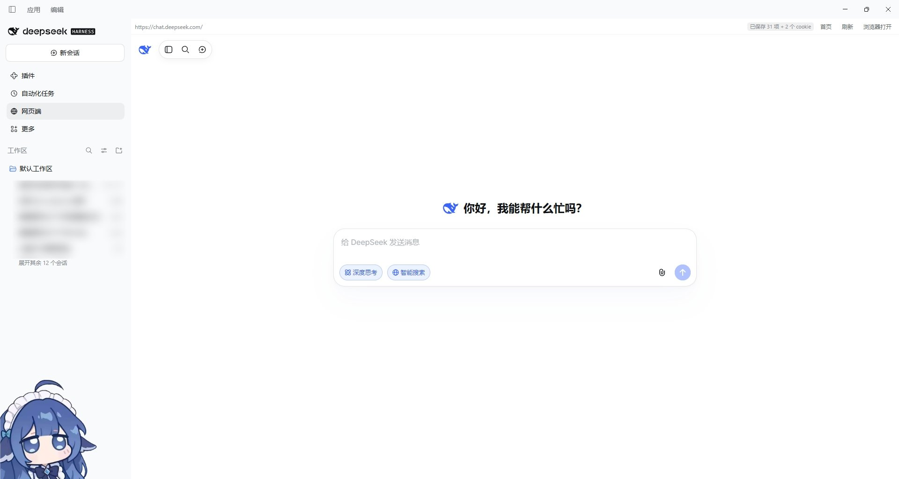
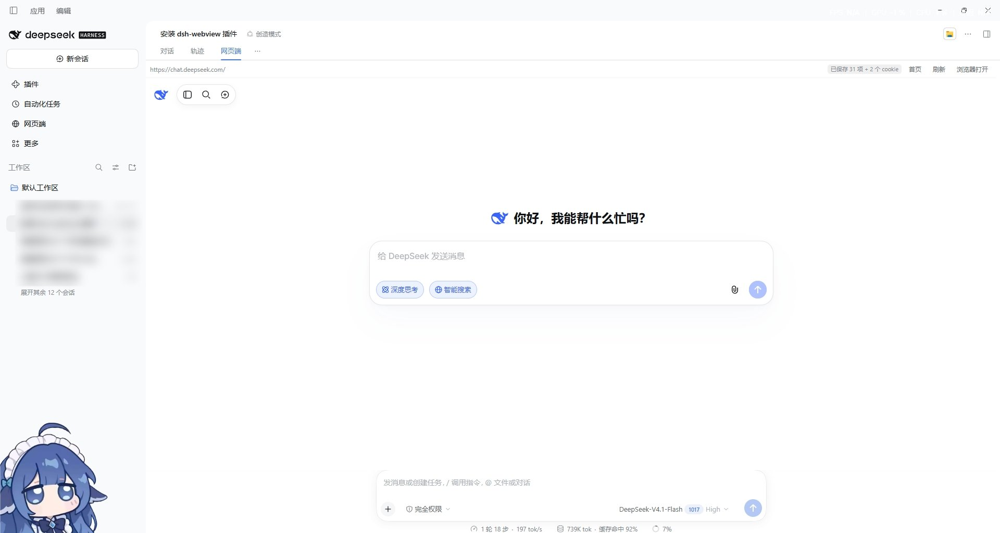

[简体中文](README.md) · [English](README.en.md)

# dsh-webview · 网页端

在 DSH 桌面端里直接打开 [chat.deepseek.com](https://chat.deepseek.com)：不用切浏览器，不用重新登录。

> 🤖 **本插件完全由 AI 制作**：代码、文档、图标均由 DSH 内的 AI agent 生成，未经人工逐行编写。

---

## 三个入口，一个页面

| 入口 | 位置 | 适合 |
| --- | --- | --- |
| **会话视图标签** | 会话区顶部「对话｜轨迹｜上下文」旁的 **网页端** | 边聊边查，跟着当前会话走 |
| **左上角面板列** | 「插件」「自动化任务」旁的地球图标 | 全屏使用，随时进出 |
| **主区域面板** | 上面两个入口点开后的全屏面板 | 沉浸式，左侧栏仍可操作 |

三个入口**共享同一个页面实例**：在标签里滚到某处，切到面板再切回来，页面还在原处；登录状态、正在输入的内容都不会丢。

---

## 为什么选它

同类插件大多只提供一个全局面板。dsh-webview 的差异点：

| 维度 | dsh-webview | 常见内嵌方案 |
| --- | --- | --- |
| 会话视图标签入口 | ✅ 有（同类中未见） | ❌ 只有全局按钮 |
| 多入口共享同一页面 | ✅ 三个入口一个实例，切走不卸载 | ⚠️ 少见 |
| 宿主半侧代码 | ✅ 零（`lib/index.js` 是空插件，只为让加载器看见） | ⚠️ 通常需要，用来搬运 HttpOnly cookie |
| 页面权限 | ✅ 最小：不读文件、不碰凭证、不发请求 | ⚠️ 视实现而定 |
| 导航范围 | ✅ 白名单 `deepseek.com`，越界交系统浏览器 | ⚠️ 多为不限制 |
| 体积 / 依赖 | ✅ 单文件约 22KB，零运行时依赖，无构建步骤 | ⚠️ 常见数百 KB 起 |

**不代你发请求**：不注入页面脚本、不轮询接口、不预加载、不代理任何请求。插件做的事只有一件——把网页端放进一个受控的内嵌浏览器里。

---

## 截图





---

## 安装

桌面端自带包管理器，**不需要自己装 Node.js**：

```bash
dsh plugin --profile desktop add dsh-webview
```

装完重启 DSH：左上角面板列出现地球图标，会话区标签栏多一个「网页端」。

离线安装（把 `dsh-webview-0.3.0.tgz` 放在本地）：

```bash
dsh plugin --profile desktop add "C:\path\to\dsh-webview-0.3.0.tgz"
```

---

## 使用

1. 任选一个入口打开：会话区顶部的 **网页端** 标签，或左上角的地球图标
2. 第一次在页面里登录 DeepSeek 账号（之后重启 DSH 通常不必再登录）
3. 顶部工具条提供 **刷新** 与 **在浏览器打开**

**那个"使用环境异常"弹窗**：DSH 桌面端是 Electron 容器，DeepSeek 的风控会识别出"这不是常规浏览器"。本插件只剥离 UA 里的 `Electron/<版本>` 标记，其余 Chromium 指纹原样保留——不冒充别的浏览器、不伪造版本号。绝大多数情况下不再出现；若偶尔出现，直接关掉即可，**不影响登录和对话**。

---

## 登录是怎么保住的

宿主给内嵌页面的是**内存分区**（随机名、无 `persist:` 前缀，关掉进程就清空），所以插件自己保存会话快照：

- 页面加载完成、切换面板、关闭窗口时，读出页面的 `localStorage` 与脚本可读的 cookie，存进 DSH 外壳的 `localStorage`
- 下次启动时，在页面自身脚本初始化**之前**把快照写回去，有变化只重载一次；期间盖一层遮罩，看不到登录页闪烁

快照与浏览器"记住登录"是同一性质，**只存在你这台机器上**，不上传、不联网。`HttpOnly` cookie 页面读不到，所以极少数情况下仍需重新登录一次。

---

## 已知限制

- **仅桌面端**：网页版 DSH 没有 Electron 宿主，面板会提示"当前环境不支持内嵌浏览器"
- **页面权限受限**：摄像头、麦克风、剪贴板读取、下载默认不可用（宿主安全策略）
- **标签栏依赖会话**：没有任何打开的会话时，会话视图标签栏不渲染，此时用左上角图标进入
- **面板位置固定**：按钮在左侧面板列末尾

---

## 兼容性

| DSH 版本 | 状态 |
| --- | --- |
| 0.2.1-rc.1 及以上（desktop） | 已验证可用 |
| 网页版 DSH | 不支持（显示降级提示） |

插件只依赖公开的客户端插槽（`sidebar.panellist` / `main` / `conversation.view`）与宿主 `dshDesktop.browser` 桥。同一 0.2.x 小版本更新一般无需改动；跨大版本可能需小幅适配。

---

## 实现要点

- 注册三个插槽：`sidebar.panellist`（左上角按钮）、`main`（主区域面板）、`conversation.view`（会话区标签）；后两者与前者共用同一个 `<webview>` 实例
- 通过 `window.dshDesktop.browser.acquire()` 申请 lease 与内存分区，再创建 `<webview>`
- 保活：`<webview>` 挂在 `document.body` 上的单例容器里，面板切换只改 `display`，DOM 永不离场，页面因此不重载
- 导航白名单 `deepseek.com`；越界链接交给系统浏览器（2 秒内同一 URL 去重，避免重复弹窗）
- UA：`webview.setUserAgent()` 只去掉 `Electron/x.y.z`，保留其余 Chromium 标记

---

## 卸载

```bash
dsh plugin --profile desktop remove dsh-webview
```

## 开发

```
lib/index.js     宿主半侧（空插件，让加载器条目可见）
lib/client.js    浏览器半侧（插槽 + webview），经 window.__ModuleLoader__ 加载
cordis.patch.yml bundle 补丁，插入 id 为 `webview` 的条目
```

## 许可证

MIT © 2026 dsh-webview contributors
